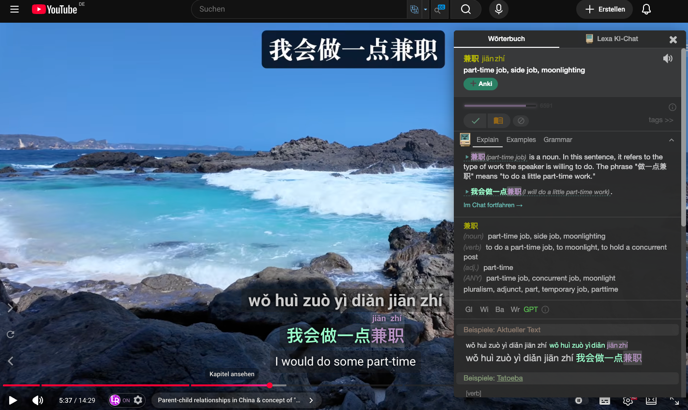
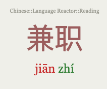
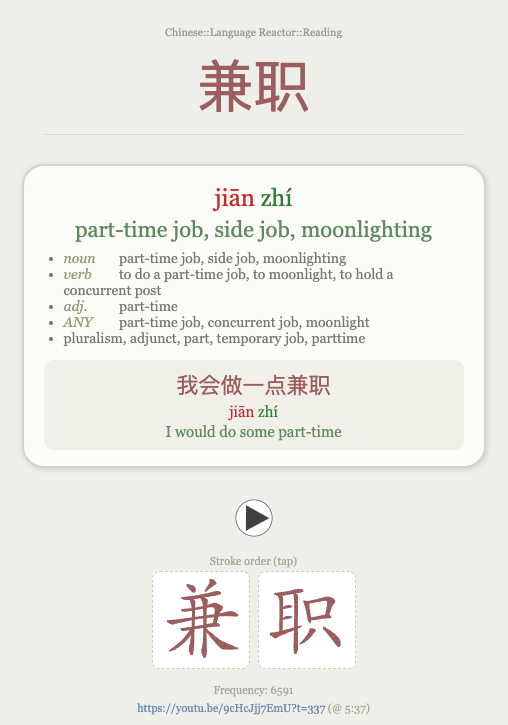
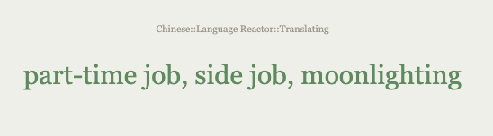
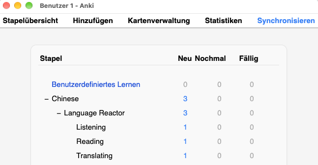
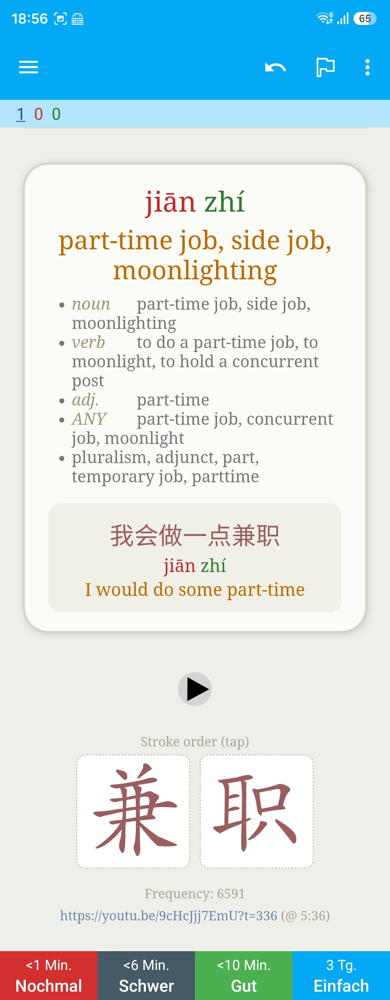
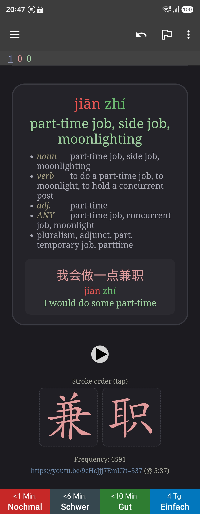

# languageReactor2Anki

A browser extension that turns Chinese vocabulary you meet while watching YouTube with
[Language Reactor](https://www.languagereactor.com/) (LR) into rich Anki cards with a single click.
Each card carries the word (Hanzi), Pinyin, translation, the current subtitle sentence, stroke-order
animations and a timestamped link back to the exact moment in the video.

Cards are sent straight into a running Anki Desktop via [AnkiConnect](https://ankiweb.net/shared/info/2055492159),
so you can create them on your computer and study them on your phone after a sync.

> **Language scope:** despite the generic name, the **language being learned is Chinese (Mandarin),
> and this is fixed**. The extraction and card features are Chinese-specific: Pinyin (with tone colors),
> Hanzi handling, stroke-order animations and `zh_CN` TTS.
>
> The **translation language** (the meaning shown on the card) is whatever you set Language Reactor to
> display, e.g. German, French or English. A **Latin-script** translation language works best; a
> CJK-script translation (e.g. Japanese) may be trimmed incorrectly.

## Screenshots

### Capturing on YouTube

Click a word in Language Reactor, then the **➕ Anki** button in the panel:

### The resulting Anki cards (desktop)

| Reading - front | Reading - back |
| --- | --- |
|  |  |

| Translating - front | Deck overview |
| --- | --- |
|  |  |

### On your phone (AnkiDroid)

The same cards after syncing, in light and dark mode:

| Light | Dark |
| --- | --- |
|  |  |

## Features

- **One-click capture**: an "➕ Anki" button appears inside LR's dictionary panel when you click a word.
- **Tri-directional cards** from a single note, each training a different skill (no redundant cards):
  - **Reading**: Hanzi → reveal Pinyin → translation
  - **Translating**: translation → Hanzi + Pinyin
  - **Listening**: audio → Hanzi + Pinyin + translation
- **Optional Pinyin** you can tap to reveal (works offline on mobile too).
- **Stroke-order animations** per character, tap to play, stored offline.
- **Pinyin tone colors** (Pleco scheme), switchable in the options.
- **Pronunciation** via Anki's built-in text-to-speech.
- **Per-skill subdecks** (`…::Reading`, `…::Translating`, `…::Listening`) so each skill can be studied
  or suspended on its own.
- **Duplicate-aware**: a word with the same meaning and sentence is not added twice; the same word in
  a *different* sentence is added as a new card. The source link/timestamp is ignored for this check
  (as is the frequency rank, which Language Reactor does not always display).
- **Automatic field cleanup** (Pinyin that LR mixes into the Chinese/translation lines is removed) and
  **dark-mode-aware** card styling.

## Requirements

- Google Chrome (or a Chromium browser) with the Language Reactor extension.
- Anki Desktop running, with the **AnkiConnect** add-on installed.

## Installation

### 1. Install AnkiConnect
In Anki: `Tools > Add-ons > Get Add-ons…`, enter code `2055492159`, restart Anki. Keep Anki running
while adding cards.

### 2. Install the extension
Pick whichever fits you:

- **From a release zip (no build needed):** download the latest `...-chrome.zip` from the
  [Releases](https://github.com/kagahd/languageReactor2Anki/releases) page and unzip it. Then in
  `chrome://extensions` enable **Developer mode**, click **Load unpacked**, and select the unzipped
  folder.
- **Build it yourself:** see [DEVELOPER.md](DEVELOPER.md), then load the `.output/chrome-mv3` folder
  the same way (Developer mode → Load unpacked).

(A one-click Chrome Web Store install is planned; until then, loading unpacked requires Developer
mode.)

### 3. Grant AnkiConnect access
On first use, Anki shows an "Allow connection" popup — click **Yes**. The origin is then remembered.
If no popup appears, add the extension id (`chrome-extension://<id>`) to AnkiConnect's
`webCorsOriginList` config.

## Language Reactor settings

The extension reads what Language Reactor shows, so a few LR settings matter. Open them via the LR
toolbar icon.

**Required** (otherwise fields come out empty or wrong):
- **YouTube subtitle language: Chinese (China)** — the words and sentences being read.
- **Machine translation: on** — provides the sentence translation (the human translation is usually
  "not available").
- **Translation language: a Latin-script language** (e.g. German or English) — the meaning shown on
  the card.
- **Show transliterations: "With original form"** (German UI: *Transliterationen anzeigen → Mit
  Originalform*) — the verified way to capture the **sentence Pinyin**. LR renders each subtitle word
  as Pinyin **plus** its original Hanzi, which the extension reads per syllable. (The extension also
  reads a Pinyin reading from LR's romanization/translation line and prefers it when present, but in
  testing that line carried only the translation, so the per-word transliteration was the actual
  source.) The other two modes do not provide the per-word Pinyin: *"No transliterations"* shows none,
  and *"Only transliterations"* renders it in a structure the extension does not read. With a
  Chinese-only subtitle and no Pinyin on the translation line either, cards come out without sentence
  Pinyin.

  Note what does **not** depend on this: the **sentence Hanzi** is always captured, and the **Pinyin,
  translation and meanings of the word you looked up** come from the dictionary panel. So only the
  sentence Pinyin needs "With original form".

**Recommended:**
- **Show romanization: "Always"** (German UI: *Umschrift anzeigen → Immer*) — kept as a safe default
  so a transliteration is shown for every word rather than only known/marked ones. (Verified with
  "Always"; the narrower options were not tested.)

**Does not matter** (the extension handles it either way):
- Mini dictionary, subtitle controls, highlight colors, and similar display toggles.

## Usage

1. Open a YouTube video with Language Reactor active and dual subtitles showing.
2. Click a Chinese word so LR's dictionary panel opens.
3. Click **➕ Anki** in the panel. A toast confirms the card was saved.
4. Sync Anki to study on your phone.

> **TTS voice:** pronunciation uses Anki's built-in TTS (`zh_CN`), so a Chinese text-to-speech voice
> must be available on the device. Desktop Anki usually has one; on AnkiDroid/AnkiMobile you may need
> to install a Chinese TTS engine/voice, otherwise the play button stays silent.

## Settings

Open the options page via `chrome://extensions` → the extension → **Details > Extension options**.

| Setting | Default |
| --- | --- |
| AnkiConnect URL | `http://127.0.0.1:8765` |
| Deck | `Chinese::Language Reactor` |
| Note type | `Language Reactor Chinese` (3 card types) |
| Pinyin tone colors | on |
| TTS audio | on |

Saving re-applies the note type styling to Anki immediately (if Anki is reachable).

## Development

See [DEVELOPER.md](DEVELOPER.md) for architecture, build scripts, tests, the input-cleaning details,
and how to maintain the extension when Language Reactor changes.

## Disclaimer

This extension is for **personal language-learning use**. It reads what Language Reactor already
displays in your browser and, at your request, copies small snippets (a word, its translation, the
current sentence) into your own Anki collection. It does **not** redistribute any YouTube or
Language Reactor content, and it sends no data to the author.

Please respect the Terms of Service of YouTube and Language Reactor. If you redistribute this tool or
use it commercially, review those terms and your local copyright law first. This project is not
affiliated with or endorsed by Language Reactor, YouTube/Google, or Anki.

## Licenses

- Code: MIT (see [LICENSE](LICENSE)).
- [HanziWriter](https://hanziwriter.org) — MIT.
- Stroke data (`hanzi-writer-data`, from the Make Me a Hanzi project) — Arphic Public License.
